# TransitaSP — App mobile (Flutter)

Projeto da disciplina de Desenvolvimento Cross Platform, referente a **Global Solution 2026.2 —
CitizenTech**. Projeto **TransitaSP**:
ajudar o trabalhador a decidir, antes de sair de casa, qual e a melhor forma
de chegar ao trabalho hoje, comparando metro/trem com carro ou moto.

## Desenvolvedores

| Nome completo | RM |
| --- | --- |
| Enzo Demitrius Carvalhaes | 558912 |
| Rafael Vitor de Almeida | 559116 |
| Vitor Silva Batista | 558865 |

## Tema da Global Solution

CitizenTech: mobilidade do trabalhador na Grande Sao Paulo. O app cadastra a
rotina do usuario (origem, destino, horario, dias e modais) e apresenta uma
recomendacao do dia entre metro/trem e carro/moto, com base no status das
linhas (simulado) e em um fator de transito simulado — conforme descrito no
Pitch do projeto. Os dados reais de metro/trem nao possuem API publica
oficial, por isso o MVP simula essa parte e deixa isso declarado nas telas.

## Fluxo de telas

```
Splash
  -> (primeira vez)  Onboarding (3 paginas) -> Home
  -> (ja visitou)     Home

Home
 ├── Minhas rotinas
 │     ├── Nova rotina  (volta para Minhas rotinas)
 │     └── [toque no item] -> Recomendacao da rotina (detalhe)
 ├── Nova rotina
 ├── Status das linhas (simulado)
 └── Sobre o TransitaSP
```

- **Splash** verifica no `SharedPreferences` se o onboarding ja foi visto e
  direciona automaticamente para Onboarding ou Home.
- **Onboarding** tem 3 paginas (PageView), botoes Avancar/Voltar, opcao
  "Nao mostrar novamente" e salva a preferencia ao finalizar.
- **Navegacao** entre as 6 telas principais (Home, Minhas rotinas, Nova
  rotina, Recomendacao, Status das linhas, Sobre) usa `Navigator.push` /
  `Navigator.pop`, com passagem de parametros (a `Rotina` e passada da lista
  para a tela de Recomendacao).

## Capturas de tela

<table>
  <tr>
    <td></td>
    <td>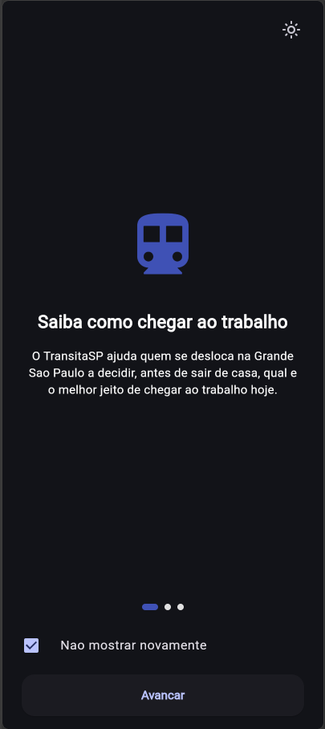</td>
    <td>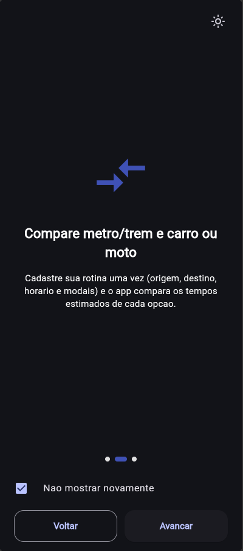</td>
  </tr>
  <tr>
    <td>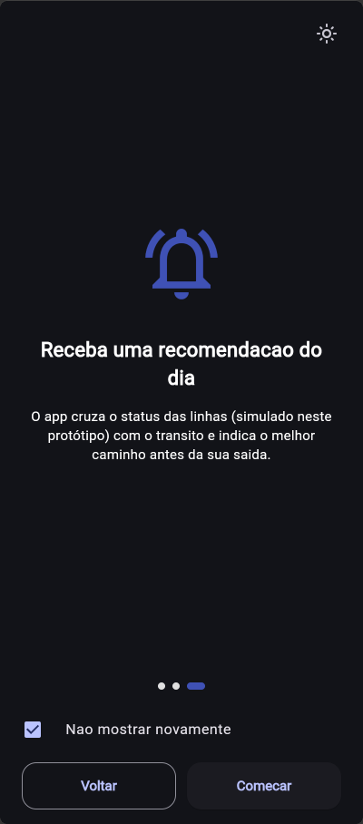</td>
    <td>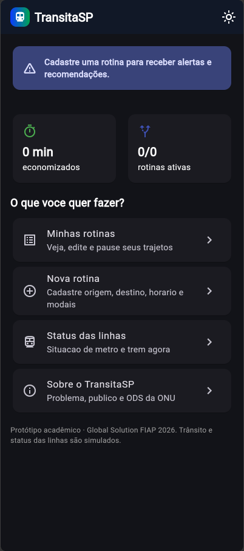</td>
    <td>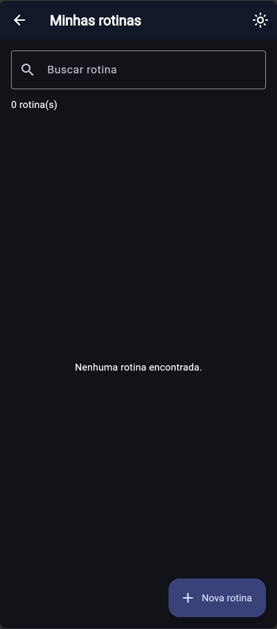</td>
  </tr>
  <tr>
    <td>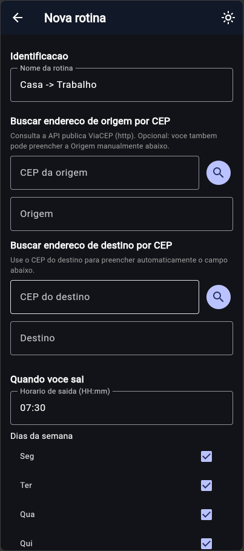</td>
    <td>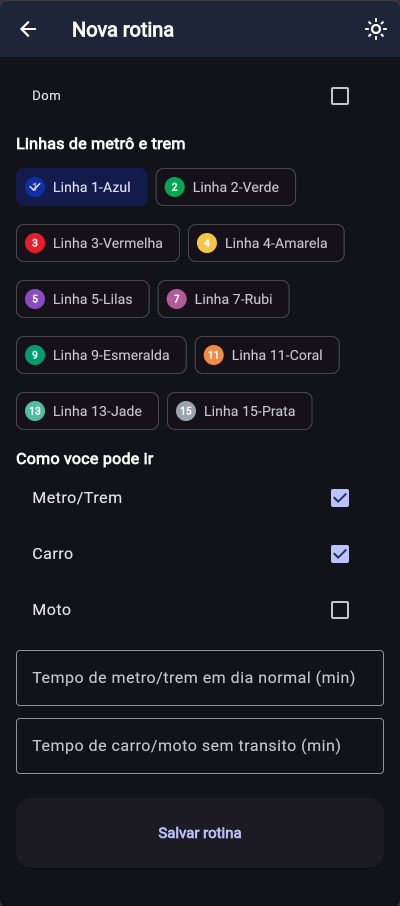</td>
    <td>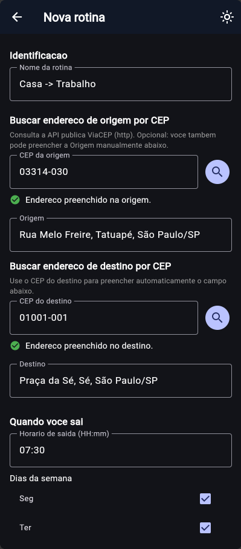</td>
  </tr>
  <tr>
    <td>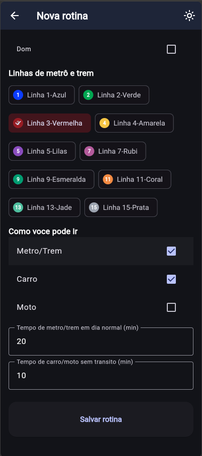</td>
    <td>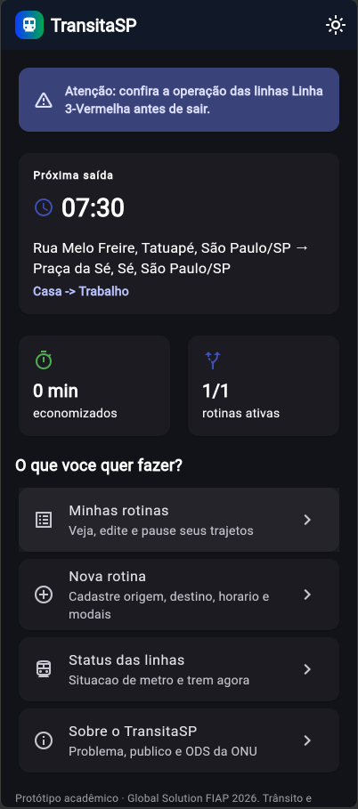</td>
    <td>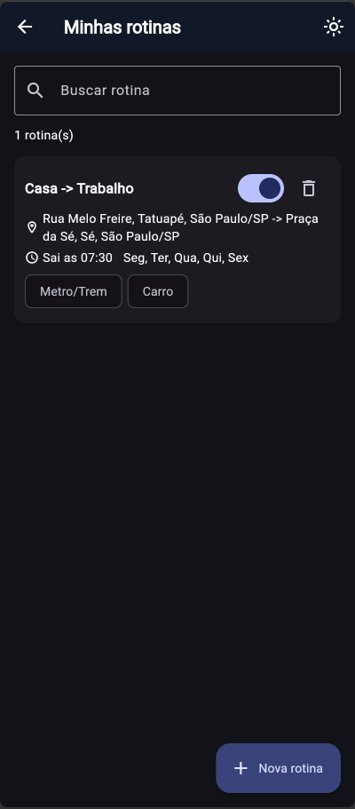</td>
  </tr>
  <tr>
    <td></td>
    <td></td>
    <td>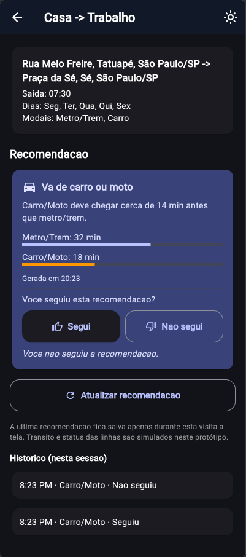</td>
  </tr>
  <tr>
    <td>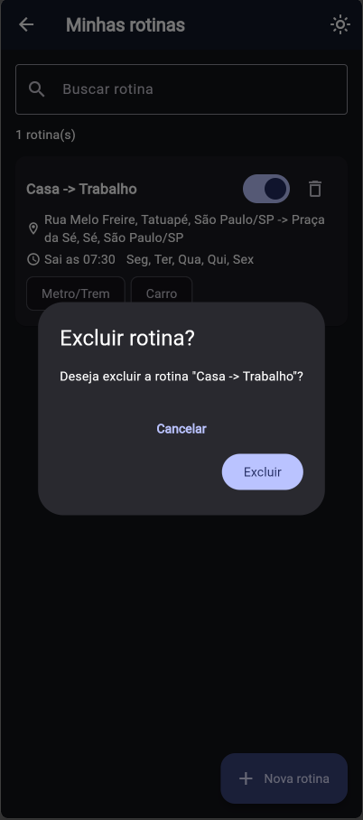</td>
    <td>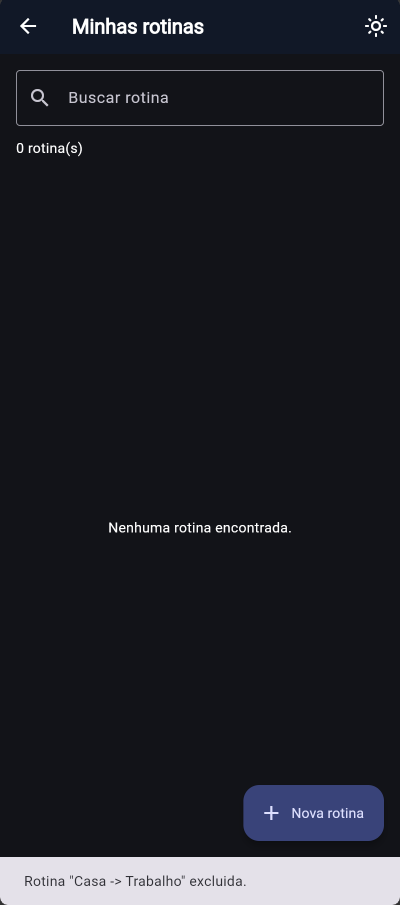</td>
    <td>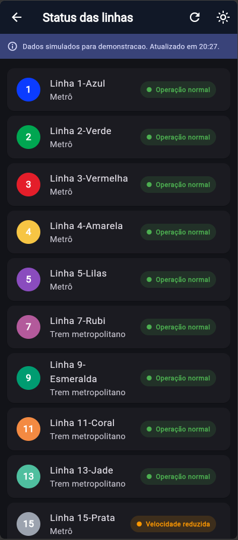</td>
  </tr>
  <tr>
    <td>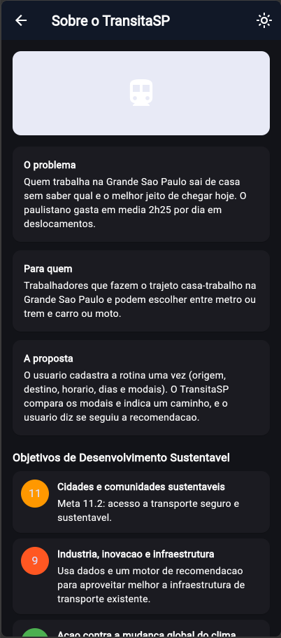</td>
    <td>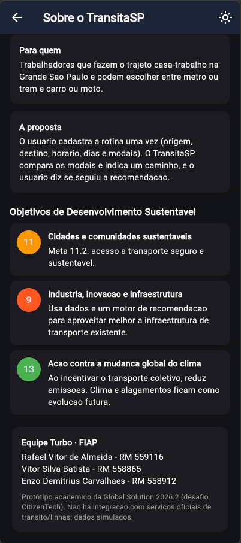</td>
    <td>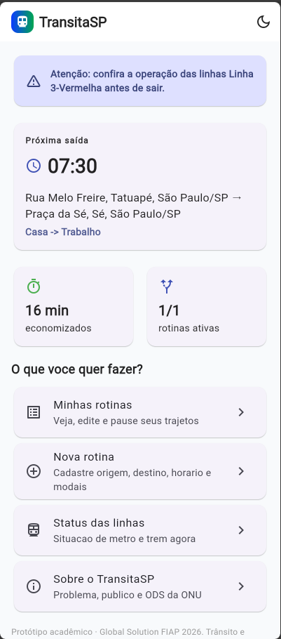</td>
  </tr>
  <tr>
    <td>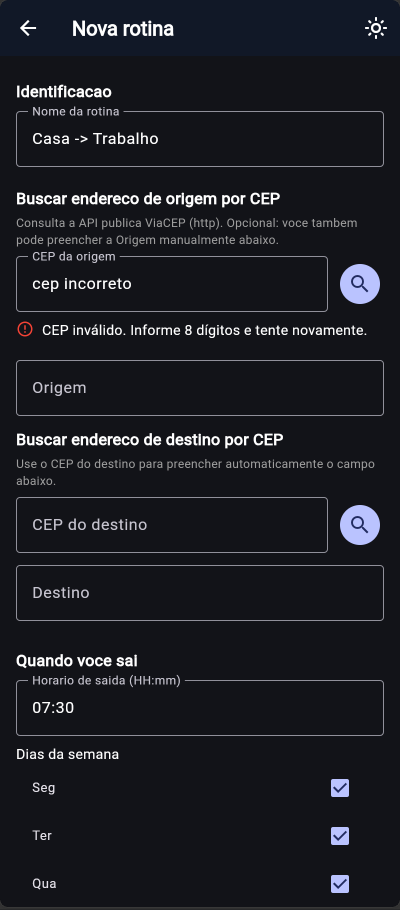</td>
    <td>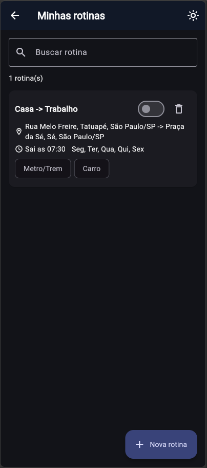</td>
    <td>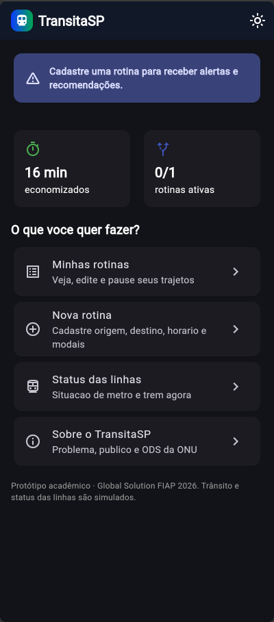</td>
  </tr>
</table>

## API utilizada (WebService)

Consumo real de uma API REST publica e gratuita, sem necessidade de chave:
**ViaCEP** (`https://viacep.com.br/ws/{cep}/json/`).

Na tela **Nova rotina**, o usuario pode digitar um CEP e tocar em buscar; o
app faz a requisicao HTTP (`package:http`), converte o JSON em um objeto
Dart (`Endereco.fromJson`) e preenche o campo Origem automaticamente. Os 4
estados pedidos no enunciado sao tratados explicitamente:

- **Inicial**: nenhuma consulta feita ainda.
- **Carregamento**: `CircularProgressIndicator` enquanto aguarda a resposta.
- **Sucesso**: endereco exibido e campo preenchido.
- **Erro**: mensagem de erro (CEP invalido, nao encontrado ou falha de
  rede) com botao **Tentar novamente**.

O status das linhas de metro/trem e a comparacao de tempo entre os modais
(o "motor de recomendacao") sao **simulados localmente**, pois nao existe
API publica oficial para o status das linhas — conforme validado no Pitch
do TransitaSP.

## Persistencia local

`shared_preferences` guarda:
- se o onboarding ja foi visto;
- a lista de rotinas cadastradas (serializadas em JSON);
- o total de minutos economizados (feedback "Segui"/"Nao segui").

## Arquitetura / organizacao do projeto

```
lib/
├── main.dart
├── models/
│   ├── rotina.dart        # rotina cadastrada (fromJson/toJson)
│   ├── endereco.dart       # resposta da API ViaCEP (fromJson)
│   └── linha_status.dart   # linha de metro/trem simulada (enum com label)
├── services/
│   ├── preferences_service.dart     # SharedPreferences (onboarding, rotinas, minutos)
│   ├── endereco_service.dart        # consumo HTTP da API ViaCEP
│   ├── status_linhas_service.dart   # geracao do status simulado das linhas
│   └── recomendacao_service.dart    # motor de recomendacao (comparacao de tempos)
├── screens/
│   ├── splash_screen.dart
│   ├── onboarding_screen.dart
│   ├── home_screen.dart
│   ├── rotinas_screen.dart
│   ├── nova_rotina_screen.dart
│   ├── recomendacao_screen.dart
│   ├── status_linhas_screen.dart
│   └── sobre_screen.dart
└── widgets/
    ├── rotina_card.dart
    └── linha_status_tile.dart
```

A separacao segue o mesmo padrao usado nos tutoriais da disciplina
(models / services / screens / widgets): as telas (`StatefulWidget`) cuidam
apenas da interface e chamam os `services` para persistencia, consumo HTTP e
regras de recomendacao — sem logica de negocio dentro dos widgets. O estado
e gerenciado com `setState`, sem bibliotecas externas de gerenciamento de
estado.


## Como executar

```bash
flutter pub get
flutter run
```

## Observacoes importantes

- Protótipo academico (Global Solution FIAP 2026.2). Nao ha integracao com
  servicos oficiais de transito ou status de linhas de metro/trem: esses
  dados sao simulados, conforme declarado nas proprias telas do app.
- A unica chamada de rede real do app e a consulta publica ao ViaCEP,
  usada no cadastro da rotina.
